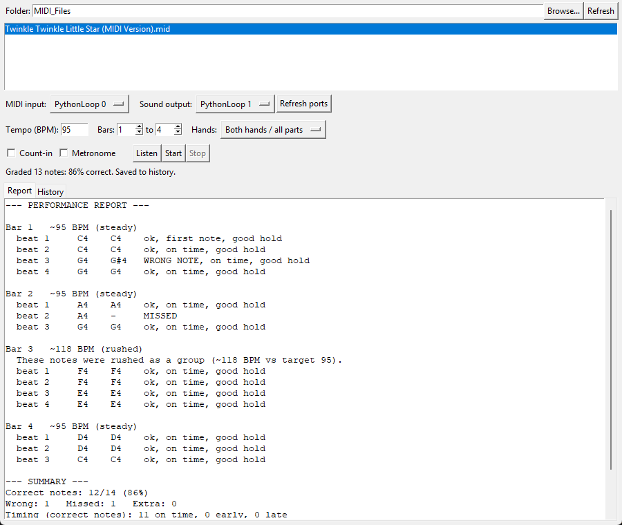
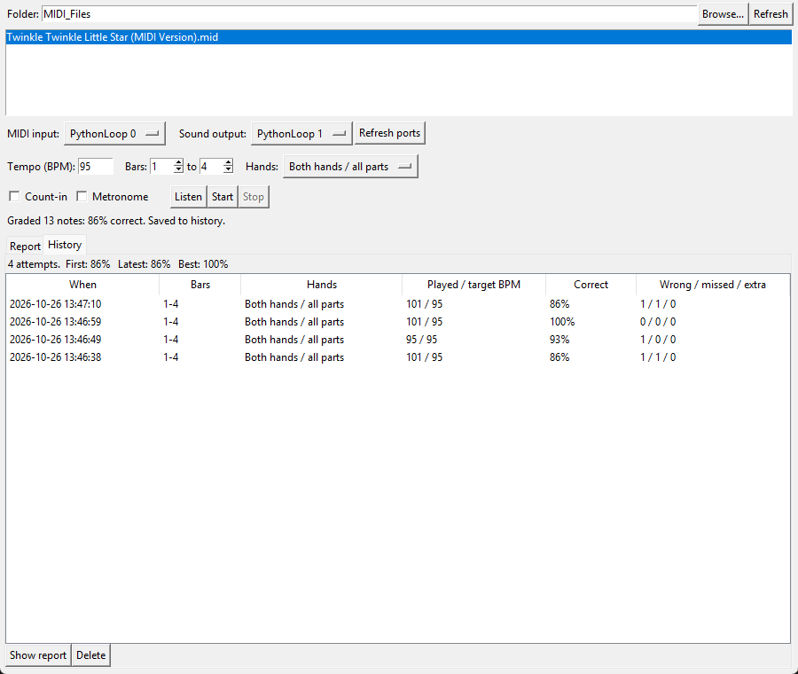

# Piano Practice Grader

A desktop program that listens to you play the piano and compares your
performance with the sheet music. It reports which notes were wrong, missed or
extra, whether each note was early, late or held for the right length, and
which bars you rushed or dragged.

## Why I made this

I made this app because when I was learning piano without an instructor, I often made repeated significant mistakes that were etched into my playing and were very difficult to correct. This app allows me to spot my mistakes early, and fix them before muscle memory kicks in.

## Features

- Pick a piece from any folder of MIDI files.
- Grading: wrong, missed and extra notes; chords in any order (rolled
  chords and a late left hand are fine); timing per note; how long each note
  is held, including the sustain pedal.
- Tempo by bar: "bars 5–8 rushed (~110 BPM vs 95)", reported per group
  rather than flagging every note.
- Practice tools: choose a tempo, a range of bars, and one hand or both;
  an optional count-in and metronome; "Listen" plays the selected bars first.
- History: every attempt is saved with its full report, so progress can be
  tracked; attempts can be deleted one by one.

## Setup

1. Install Python 3.10 or newer, then the libraries:
  `pip install -r requirements.txt`
2. Connect a keyboard:
  - A digital piano: connect it by USB (or a USB-MIDI cable) and pick it
    under MIDI input.
  - No piano: install loopMIDI (https://www.tobias-erichsen.de/software/loopmidi.html),
    create a port called `PythonLoop`, and send notes into it from a virtual
    keyboard such as VMPK (https://vmpk.sourceforge.io/).
3. Run the program: 
  `python gui.py`
  There is also a terminal version: `python app.py --help`.

## How it works

`sheet.py`: Reads a MIDI file (with music21) into the notes to play, by bar and by hand.
`recorder.py`: Records the keyboard, with timestamps from the MIDI driver and sustain-pedal tracking.
`grader.py`: Lines up what was played with the sheet, and judges notes, timing and tempo.
`report.py`: Turns the results into the text report.
`playback.py`: Count-in, metronome, and "Listen".
`history.py`: Saves attempts to `history.json`.
`gui.py`, `app.py`: The window and the terminal version.

The hard part is deciding which played note belongs to which written note when
the player makes mistakes. The grader does this in two passes:

1. Rough match on pitch only: (an edit-distance alignment, like a spell
   checker comparing two words). From the notes that clearly match, it
   estimates the player's tempo with a robust line fit, so a few bad matches
   can't skew it.
2. Chord-by-chord match usin pitch and timing: Each chord on the sheet
   claims a group of nearby played notes in any order. A wrong-pitch note is
   expected at the right time; far from it, "missed + stray note" is the
   better explanation.

Timing is judged against the tempo you were actually playing in each bar, so
practising slowly doesn't mark every note late, and a single late note doesn't
make the next one look early.

## Testing

There are 156 automated tests (`python -m unittest discover -s tests`). They
cover tricky MIDI files, hand-made performances with known answers, the GUI,
and live recording through a loopMIDI port (fast bursts, the sustain pedal,
timing accuracy while the computer is busy).

A "virtual pianist" (`tests/benchmark.py`) plays pieces, including Bach
chorales, with human-like timing wobble, rolled chords and random mistakes,
and checks the grader against what it really did:

Careful / average / sloppy timing: no mistakes made
150 ms rolled chords, pedal, 70% speed: no mistakes made
5% of notes wrong, missed or extra: 0.01% correct notes wrongly flagged, 99.8% mistakes found
15% of notes wrong, missed or extra: 0.02% correct notes wrongly flagged, 98.9% mistakes found

The program has been tried and works with a real piano.

## Limitations

- Only the first tempo in a file is used.
- Grading a very long piece takes a moment (about 2 s for 2,500 notes).

## How this was built

I designed the project, and wrote the first working prototype code; I then developed it into the full program with the help of Claude, an AI assistant, which helped me optimize and polish the final code. I directed the features and design decisions and tested the results.
`experiments/first_prototype.py` is the first working version, before that
help; the other files in `experiments/` are earlier experiments.
